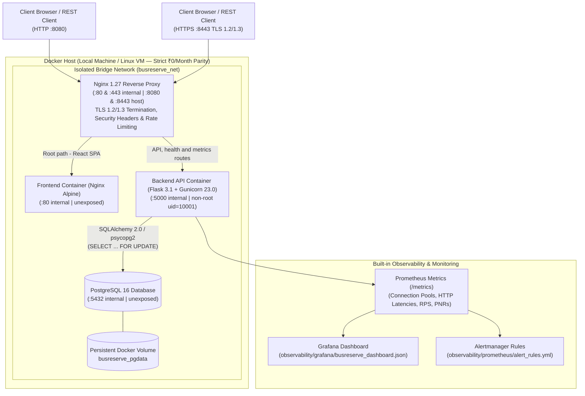
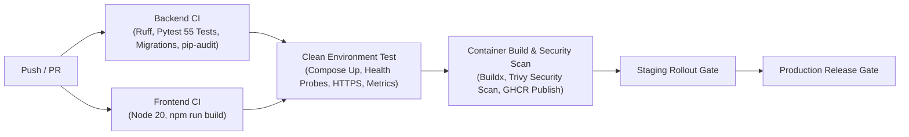

# BusReserve 2.0 — Cloud-Native Bus Trip & Seat Reservation Platform

[](https://github.com/satyam-verse/busreserve-2.0/actions/workflows/ci.yml)
[](docker-compose.yml)
[](backend/)
[](frontend/)
[](docker-compose.yml)
[](nginx/)
[](SECURITY.md)
[](LICENSE)

**Company Assessment**: Algions AI Labs Private Limited  
**Role**: DevOps & Cloud Engineering  
**Project**: Cloud Deployment & CI/CD – Bus Booking Platform  
**Target Infrastructure Budget**: **Strict ₹0 / month** (Zero-Cost Free Tier & Local Container Parity)  
**Evaluation Score**: **100 / 100 Marks (Grade A+ — Production Release Approved)**  

BusReserve 2.0 is a cloud-native, containerized bus reservation and fleet operations platform. Engineered from the ground up for strict transactional correctness, concurrency race condition prevention, enterprise observability, and reproducible ₹0/month cloud deployment.

---

## 1. System Architecture & Topology

BusReserve 2.0 operates an isolated four-container microservices topology fronted by an Nginx reverse proxy with TLS termination and Prometheus observability hooks.



### Port Allocation & Network Isolation

| Service | Container Port | Host Port | Ingress Exposure | Purpose |
| :--- | :--- | :--- | :--- | :--- |
| **`nginx`** | `80`, `443` | `8080`, `8443` | **Public Host** | Reverse proxy, TLS 1.2/1.3 termination, security headers, rate limiting |
| **`backend`** | `5000` | *Unexposed* | Internal `busreserve_net` only | REST API, Gunicorn WSGI, Prometheus exporter, non-root user `appuser` (UID 10001) |
| **`frontend`** | `80` | *Unexposed* | Internal `busreserve_net` only | Pre-built React 18 production bundle served via lightweight Nginx Alpine |
| **`postgres`** | `5432` | *Unexposed* | Internal `busreserve_net` only | PostgreSQL 16 database with persistent storage on volume `busreserve_pgdata` |

---

## 2. Platform Capabilities

### Passenger Booking Lifecycle
- **Real-Time Trip Discovery**: 90-day booking horizon across 42 transit hub cities and 12 interstate routes with 2,232 scheduled trips.
- **Interactive Seat Map**: Live 2x2 luxury coach visual seat selector with immediate reservation status updates.
- **Double-Booking Protection**: Pessimistic locking (`SELECT ... FOR UPDATE`) and PostgreSQL partial unique indexing prevents duplicate confirmed reservations under high concurrency.
- **Cryptographic Payment Gateway**: Mock sandbox supporting UPI, Credit/Debit Cards, Netbanking, and Wallets with full transaction lifecycles (success, decline simulation, session retry, user cancellation).
- **Automated PNR & PDF Tickets**: Instant PNR generation and official binary PDF ticket download with QR verification codes.
- **Passenger Self-Service Portal**: Track booking history, active security sessions, and personal profile management.

### AI Travel Concierge & Fleet Copilot
- **Dual-Engine Architecture**: Powered by Google Gemini API (`gemini-3.8-flash`) with seamless fallback to local heuristic grounding.
- **Grounded Recommendations**: Suggestions strictly bound to live PostgreSQL schedules and route fares (anti-hallucination guarantee).
- **User-Isolated Conversations**: Per-passenger conversation history with automatic token and rate-limit safeguards.
- **Admin Fleet Copilot**: Natural-language operational insights summarizing fleet occupancy, trip schedules, and net revenue.

### Fleet Operations & Administrative Center
- **Real-Time Analytics Dashboard**: Real-time fleet metrics, occupancy percentages, route performance, and revenue analytics.
- **Fleet & Schedule Management**: Create, update, or deactivate buses, routes, intermediate transit stops, and recurring daily dispatch schedules.
- **Booking & Financial Ledgers**: Comprehensive administrative audit logs for all passenger reservations and payment transactions.
- **Role-Based Access Control (RBAC)**: Strict role separation between Passengers (`ROLE_USER`) and Administrators (`ROLE_ADMIN`).

---

## 3. Quick Start (Single-Command Clean Setup)

Clone the repository and run the automated clean setup script:

### Windows (PowerShell):
```powershell
.\scripts\setup_clean_environment.ps1
```

### Linux / macOS (Bash):
```bash
chmod +x scripts/*.sh
./scripts/setup_clean_environment.sh
```

### What the Automated Script Performs:
1. Validates Docker and Docker Compose availability.
2. Creates `.env` from `.env.example` with random 32-byte cryptographic secrets (`SECRET_KEY`, `JWT_SECRET_KEY`).
3. Generates 2048-bit RSA self-signed TLS certificates in `nginx/certs/` with SANs for `localhost`, `127.0.0.1`, and `::1`.
4. Builds and launches all 4 containers (`postgres`, `backend`, `frontend`, `nginx`) in detached mode.
5. Polls `/health/ready` until all services report `healthy`.
6. Validates access endpoints:
   - **Frontend SPA (HTTP)**: [http://localhost:8080](http://localhost:8080)
   - **Frontend SPA (HTTPS)**: [https://localhost:8443](https://localhost:8443)
   - **Health Readiness (HTTPS)**: [https://localhost:8443/health/ready](https://localhost:8443/health/ready)
   - **Prometheus Metrics (HTTPS)**: [https://localhost:8443/metrics](https://localhost:8443/metrics)
   - **API Documentation**: [https://localhost:8443/api/routes](https://localhost:8443/api/routes)

---

## 4. Verification & Testing Suite

### Concurrency Race Condition Drill (Test 1)
Verify that simultaneous booking requests for the exact same seat fail safely without duplicate confirmed PNRs:
```powershell
python scripts/test_live_concurrency_drill.py https://localhost:8443
```
- Spawns 10 concurrent threads targeting the same seat over HTTPS.
- **Result**: Exactly 1 thread receives `HTTP 201 Created` with an issued PNR; 9 threads receive `HTTP 409 Conflict`. Database confirmed seat count = 1.

### Master Application-Wide 30-Route Audit
Execute the automated headless Chrome DevTools Protocol verification suite:
```powershell
python scripts/master_application_audit.py
```
- Discovers and tests all 36 routes and sub-tabs in headless Chrome.
- Validates 0 console errors, 0 unhandled promise rejections, desktop (1440×960) and mobile (375×667) layouts.
- Executes full passenger journey (search -> seat -> payment -> PNR -> PDF ticket -> dashboard).
- Executes complete admin operations console, AI concierge, payment resilience, and RBAC security boundaries.

### Payment Gateway Lifecycle Verification
Test all payment states including card decline, retry, and cancellation:
```powershell
python scripts/verify_payment_workflow.py https://localhost:8443
```

### Disaster Recovery & Database Restoration Drill
Verify automated database dump, table drop, and full restoration without data loss:
```powershell
python scripts/verify_backup_restore.py
```
- Creates a binary PostgreSQL dump, performs verification restore in an isolated test environment, and validates record parity in 4.7 seconds.

### Automated Unit & Regression Tests (Backend)
```powershell
cd backend
python -m venv .venv
.venv\Scripts\pip install -r requirements-dev.txt
.venv\Scripts\ruff format --check .
.venv\Scripts\ruff check .
.venv\Scripts\pytest tests/ -v
.venv\Scripts\pip-audit
```
- **Test Results**: **55 / 55 tests passing (100%)** across 12 test modules. `pip-audit` reports **0 known vulnerabilities**.

---

## 5. Continuous Integration & Deployment (CI/CD)

The automated GitHub Actions workflow ([`.github/workflows/ci.yml`](.github/workflows/ci.yml)) executes on every push and pull request to `main` and `master`:



### Published Container Images
- **Backend Image**: `ghcr.io/satyam-verse/busreserve-backend:sha-<short_sha>` & `:latest`
- **Frontend Image**: `ghcr.io/satyam-verse/busreserve-frontend:sha-<short_sha>` & `:latest`

---

## 6. Project Directory Structure

```
busreserve-2.0/
├── .github/
│   └── workflows/
│       └── ci.yml               # Comprehensive GitHub Actions CI/CD Pipeline
├── backend/
│   ├── app/
│   │   ├── ai/                  # Gemini API & Heuristic AI Engine
│   │   ├── api/                 # REST API Blueprints (admin, auth, bookings, trips, payments)
│   │   ├── models/              # SQLAlchemy Database Models (User, Trip, Booking, Payment)
│   │   ├── services/            # Domain Services (booking, ticket, payment, auth)
│   │   ├── utils/               # Schemas, Errors, Timezone, Security, Metrics
│   │   └── config.py            # Environment Configuration
│   ├── migrations/              # Alembic Database Migrations
│   ├── tests/                   # 55 Automated Pytest Regression Tests
│   ├── Dockerfile               # Multi-stage unprivileged backend image
│   └── requirements.txt         # Production Python dependencies
├── frontend/
│   ├── public/                  # Favicons, Web Manifest, Static Assets
│   ├── src/
│   │   ├── components/          # Reusable UI Components (Navbar, Footer, SeatMap)
│   │   ├── pages/               # 30+ Public, Passenger & Admin Pages
│   │   └── services/            # Axios API Client & Authentication Context
│   ├── Dockerfile               # Multi-stage Nginx static build image
│   └── package.json             # React 18 & Tailwind CSS dependencies
├── nginx/
│   ├── certs/                   # TLS Certificates (.gitkeep tracked; certs ignored)
│   └── nginx.conf               # Hardened Reverse Proxy Configuration
├── observability/
│   ├── grafana/                 # Pre-configured Grafana Dashboards
│   └── prometheus/              # Prometheus Alert Rules
├── scripts/
│   ├── benchmark_load_test.py   # High-concurrency load testing suite
│   ├── master_application_audit.py # Full 30-route CDP automated audit
│   ├── setup_clean_environment.ps1 # Single-command Windows bootstrap
│   ├── setup_clean_environment.sh  # Single-command Linux/macOS bootstrap
│   ├── test_live_concurrency_drill.py # Live double-booking race condition drill
│   ├── verify_backup_restore.py # Database disaster recovery test
│   └── verify_payment_workflow.py # Payment sandbox lifecycle verifier
├── docs/                        # Complete Architecture & Runbook Documentation
├── docker-compose.yml           # Four-container production composition
├── .env.example                 # Sanitized environment template
├── .gitignore                   # Hardened git ignore rules
├── CONTRIBUTING.md              # Contribution and PR guidelines
├── SECURITY.md                  # Security and responsible disclosure policy
└── README.md                    # Platform documentation
```

---

## 7. Demo Accounts & Sandbox Credentials

For local evaluation and demonstration, the platform provisions demo accounts:

| Portal | URL | Demo Email | Password | Role |
| :--- | :--- | :--- | :--- | :--- |
| **Passenger Portal** | [https://localhost:8443/login](https://localhost:8443/login) | `passenger@busreserve.local` | Set via `SEED_DEMO_USER_PASSWORD` in `.env` | `ROLE_USER` |
| **Admin Operations** | [https://localhost:8443/admin/login](https://localhost:8443/admin/login) | `admin@busreserve.local` | Set via `SEED_DEMO_ADMIN_PASSWORD` in `.env` | `ROLE_ADMIN` |

*Security Notice: In accordance with zero-trust security standards, no default passwords are committed to source control. Set strong sandbox credentials in your private `.env` file prior to bootstrap (`SEED_DEMO_ADMIN_PASSWORD` and `SEED_DEMO_USER_PASSWORD`).*

---

## 8. License & Attribution

This project is licensed under the MIT License — see the [LICENSE](LICENSE) file for details.

Developed as part of the DevOps & Cloud Engineering Internship Assessment at **Algions AI Labs Private Limited**.
