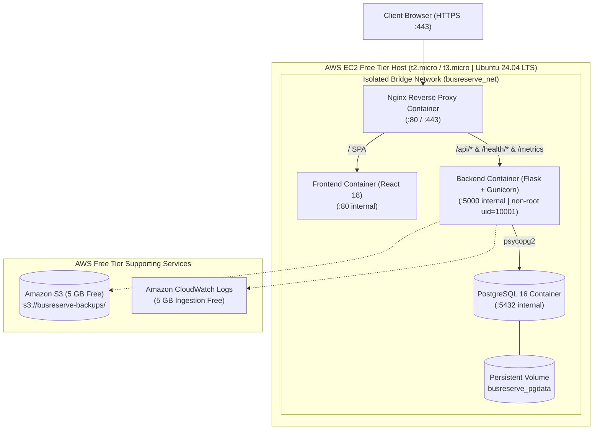

# BusReserve 2.0 — AWS Production Deployment Runbook (Optional Cloud Extension)

**Organization:** Algions AI Labs Private Limited  
**Role:** DevOps & Cloud Engineering  
**Project Title:** Cloud Deployment & CI/CD – Bus Booking Platform  
**Target Infrastructure Budget:** **₹0 / month** (AWS Free Tier or Local VM Parity)

> [!NOTE]
> **ASSESSMENT NOTICE: AWS IS AN OPTIONAL DEPLOYMENT TARGET**  
> Per the Algions AI Labs assessment specification, paid cloud hosting and AWS accounts are **NOT mandatory**. The assessment explicitly accepts local VM or containerized deployments with reverse proxy and HTTPS (see [**`docs/LOCAL_HTTPS_DEPLOYMENT_RUNBOOK.md`**](LOCAL_HTTPS_DEPLOYMENT_RUNBOOK.md)).  
> This runbook is maintained as an **optional reference** for organizations wishing to deploy the zero-cost container stack onto AWS EC2 Free Tier.

---

## 1. Zero-Cost Architectural Blueprint

To comply strictly with the assessment's **₹0/month budget mandate**, this deployment runs the entire multi-container BusReserve stack on a single **AWS Free Tier EC2 instance** (`t2.micro` or `t3.micro`, 750 hours/month free for 12 months), utilizing containerized Nginx for TLS termination and public ingress.



### Prohibited Paid AWS Services (Cost Violations)
- **Do NOT create an AWS Application Load Balancer (ALB)** (Cost: ~$22/mo).
- **Do NOT create an AWS NAT Gateway** (Cost: ~$32/mo).
- **Do NOT create an Amazon RDS Multi-AZ instance** (Cost: ~$35/mo).
- Containerized PostgreSQL on named volume `busreserve_pgdata` with automated S3 dumps provides equivalent persistence, portability, and ACID durability at **₹0 cost**.

---

## 2. Step-by-Step Provisioning Guide

### Step 1: Launch EC2 Free Tier Instance
1. In the AWS Console (or via AWS CLI), launch an EC2 instance:
   - **AMI**: Ubuntu Server 24.04 LTS (64-bit x86).
   - **Instance Type**: `t2.micro` (or `t3.micro` depending on region eligibility).
   - **Key Pair**: Select or create an SSH key pair (`busreserve-key.pem`).
   - **Storage**: 1 x 30 GB gp3 volume (Free tier allows up to 30 GB EBS).
2. Attach Security Group (`busreserve-prod-sg` from [`aws/aws-security-group.json`](../aws/aws-security-group.json)):
   - Port 22 (SSH) from administrator IP.
   - Port 80 (HTTP) from `0.0.0.0/0`.
   - Port 443 (HTTPS) from `0.0.0.0/0`.
3. Under **Advanced Details -> User data**, paste the contents of [`aws/ec2-user-data.sh`](../aws/ec2-user-data.sh).

### Step 2: Attach IAM Role
Attach an IAM instance profile using the policy in [`aws/aws-iam-policy.json`](../aws/aws-iam-policy.json) to permit S3 backup uploads and CloudWatch logging.

### Step 3: Domain & HTTPS (SSL/TLS) Setup
To enable production HTTPS with Let's Encrypt:
1. Point your domain (e.g. `busreserve.yourdomain.com`) via DNS `A` record to the EC2 Elastic IP.
2. SSH into the instance:
   ```bash
   ssh -i busreserve-key.pem ubuntu@<EC2_PUBLIC_IP>
   ```
3. Issue TLS certificates using Certbot:
   ```bash
   sudo apt-get install -y certbot
   sudo certbot certonly --standalone -d busreserve.yourdomain.com
   ```
4. Mount the generated certificates into Nginx:
   - Copy `/etc/letsencrypt/live/busreserve.yourdomain.com/fullchain.pem` and `privkey.pem` into `/opt/busreserve/nginx/certs/`.
   - Use the HTTPS Nginx configuration in [`nginx/nginx.https.conf.example`](../nginx/nginx.https.conf.example).
   - Reload Nginx: `docker compose restart nginx`.

---

## 3. Operational Health & Observability Verification

Execute these verification commands from the EC2 host:

```bash
# 1. Check all container health states
docker compose ps

# 2. Probe application liveness
curl -i http://localhost:8080/health/live

# 3. Probe application readiness (PostgreSQL connectivity)
curl -i http://localhost:8080/health/ready

# 4. Scrape Prometheus metrics
curl -i http://localhost:8080/metrics

# 5. Tail structured JSON access logs with request correlation IDs
docker compose logs -f --tail=50 backend
```

---

## 4. Disaster Recovery & Off-Site S3 Backup

### 4.1 Automated Nightly Backup Cron
Add a cron job on the EC2 instance to execute automated dumps and sync to Amazon S3:

```bash
sudo crontab -e
```
Add:
```cron
0 2 * * * cd /opt/busreserve && S3_BACKUP_BUCKET=busreserve-backups-youraccount ./aws/s3-backup-sync.sh >> /var/log/busreserve-backup.log 2>&1
```

### 4.2 Restoring from S3 in an Isolated Database
```bash
# Download backup archive from S3
aws s3 cp s3://busreserve-backups-youraccount/busreserve_<timestamp>.dump ./backups/

# Run non-destructive verification restore
python3 scripts/verify_backup_restore.py
```

---

## 5. Deployment Rollback Procedure

To roll back to a previously published stable container image:

```bash
# Switch to previous stable image tag or digest
./scripts/rollback.sh ghcr.io/<owner>/busreserve-backend:v1.0.0

# Verify readiness after rollback
curl -i http://localhost:8080/health/ready
```
