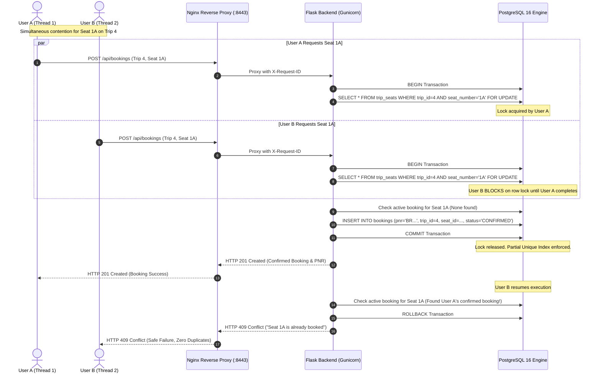
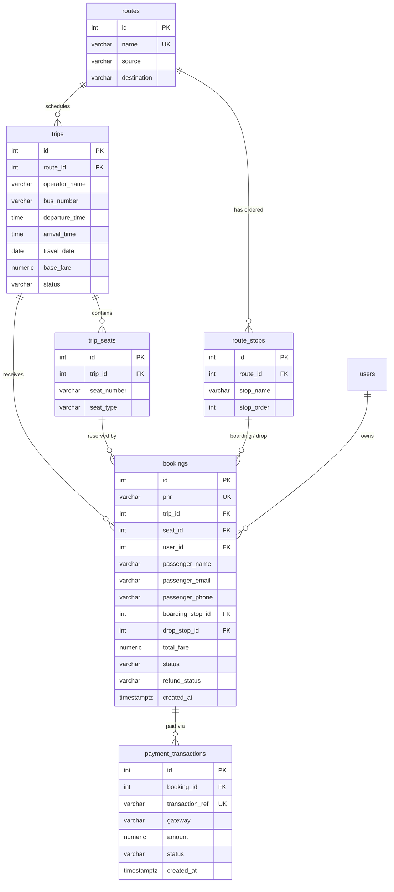

# BusReserve 2.0 — System Architecture & Technical Design

## 1. System Architecture Diagram

```mermaid
flowchart TD
    ClientHTTP["Client Browser / REST Client\n(HTTP :8080)"] --> Nginx
    ClientHTTPS["Client Browser / REST Client\n(HTTPS :8443 TLS 1.2/1.3)"] --> Nginx

    subgraph Host["Docker Host (Local Machine / Linux VM - ₹0/Month Parity)"]
        subgraph DockerNet["Isolated Bridge Network (busreserve_net)"]
            Nginx["Nginx 1.27 Reverse Proxy\n(:80 & :443 internal | :8080 & :8443 host)\nTLS Termination, Rate Limiting & Security Headers"]

            Nginx -->|"/" (React SPA)| Frontend["Frontend Container (Nginx)\n(:80 internal)"]
            Nginx -->|"/api/*"\n"/health/*"\n"/metrics"| Backend["Backend API Container (Flask 3.1 + Gunicorn 23.0)\n(:5000 internal | non-root uid=10001)"]
            Backend -->|"SQLAlchemy / psycopg2\n(FOR UPDATE + Partial Unique Index)"| Postgres[("PostgreSQL 16 Database\n(:5432 internal | unexposed)")]
            Postgres --- Volume[("Persistent Volume\nbusreserve_pgdata")]
        end
    end

    subgraph ObservabilityStack["Built-in Observability & Monitoring"]
        Backend --> Prom["Prometheus Metrics (/metrics)\n(Connection Pools, Latency Histograms, RPS)"]
        Prom --> Graf["Grafana Dashboard JSON\n(busreserve_dashboard.json)"]
        Prom --> Alert["Alertmanager Rules\n(alert_rules.yml)"]
    end
```

---

## 2. Component Responsibilities

| Component | Technology | Responsibility |
| :--- | :--- | :--- |
| **Reverse Proxy** | `nginx:1.27-alpine` | Single public ingress (`:8080` HTTP, `:8443` HTTPS), terminates TLS 1.2/1.3, routes `/` to SPA frontend, proxies `/api/`, `/health/`, and `/metrics` to Flask backend with `X-Request-ID`, `X-Forwarded-*`, security headers (`nosniff`, `SAMEORIGIN`, CSP), and bounded timeouts. |
| **Frontend SPA** | React 18, Vite 6, Tailwind CSS, Lucide Icons, React Router | Responsive UI for route search, interactive 2+2 coach seat map, passenger reservation form, PNR lookup/cancellation, and masked-PII operational demo overview. |
| **Backend API** | Python 3.12, Flask 3.1, Flask-SQLAlchemy, Flask-Migrate, Marshmallow, Gunicorn | Modular Flask app factory providing REST endpoints, strict request schema validation, structured JSON logging with `request_id`, liveness/readiness probes, and atomic booking transactions. Executes as non-root `uid=10001(appuser)`. |
| **Database** | PostgreSQL 16 | Stores routes, ordered stops, scheduled trips, seat inventory, and bookings on persistent volume `busreserve_pgdata`, enforcing double-booking prevention at the engine level. |

---

## 3. Network & Security Boundaries

1. **Host Ingress**: Only Nginx publishes ports on the host (`8080` HTTP, `8443` HTTPS). All other services bind strictly inside `busreserve_net`.
2. **PostgreSQL Isolation**: PostgreSQL port `5432` is unexposed to the host network, mitigating external brute-force and network eavesdropping risks.
3. **Least Privilege Containerization**: The backend runs as non-root user `uid=10001(appuser)`. Nginx drops privileges from master process to `nginx` user for worker processes.
4. **Header Enforcement**: Nginx automatically injects:
   - `X-Content-Type-Options: nosniff`
   - `X-Frame-Options: SAMEORIGIN`
   - `Referrer-Policy: strict-origin-when-cross-origin`
   - `Content-Security-Policy: default-src 'self' ...`
   - `Permissions-Policy: geolocation=(), camera=(), microphone=(), payment=()`
   - `Cross-Origin-Opener-Policy: same-origin`
5. **Correlation Tracking**: Nginx maps `$http_x_request_id` to `$correlation_id` (or generates a UUID4), passing it to Flask via `X-Request-ID` and returning it in all HTTP responses.

---

## 4. Concurrent Booking Protection (Pessimistic Locking Sequence)



---

## 5. Database Schema & Relational Model



### Critical Concurrency Guarantee

Two concurrent users can never reserve the same `(trip_id, seat_id)`:

1. **Row-level pessimistic lock**: `create_booking` queries `trip_seats` with `SELECT ... FOR UPDATE OF trip_seats` inside a PostgreSQL transaction.
2. **Database-level partial unique index**:
   ```sql
   CREATE UNIQUE INDEX uq_active_booking_trip_seat
   ON bookings (trip_id, seat_id)
   WHERE (status = 'CONFIRMED');
   ```
   Even if two independent sessions attempt simultaneous inserts without row locking, PostgreSQL rejects the second `CONFIRMED` row with a `23505` unique violation (`uq_active_booking_trip_seat`), which the API translates cleanly to `HTTP 409 Conflict` after rolling back.
3. **PNR atomicity & rebooking**: PNRs are generated inside the transaction; failed attempts leave zero orphaned rows. Cancelling changes `status` to `CANCELLED`, preserving audit history while immediately making the seat eligible for a new `CONFIRMED` booking.
