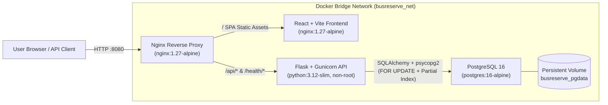
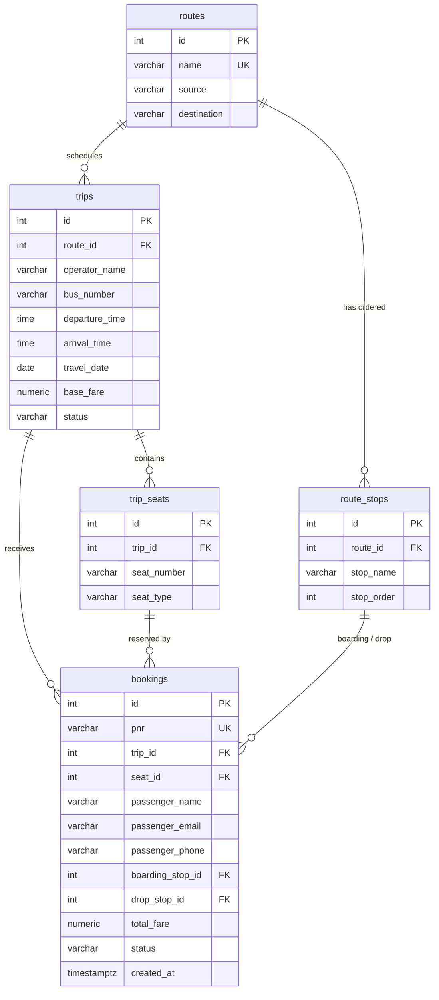

# BusReserve Architecture

## 1. System Architecture Diagram



## 2. Component Responsibilities

| Component | Technology | Responsibility |
| --- | --- | --- |
| **Reverse Proxy** | `nginx:1.27-alpine` | Single public ingress (`:8080 -> :80`), routes `/` to SPA frontend, proxies `/api/` and `/health/` to Flask backend with `X-Request-ID`, `X-Forwarded-*`, security headers, and bounded timeouts. |
| **Frontend SPA** | React 18, Vite 6, Tailwind CSS, Lucide Icons, React Router | Responsive UI for route search, interactive 2+2 coach seat map, passenger reservation form, PNR lookup/cancellation, and masked-PII operational demo overview. |
| **Backend API** | Python 3.12, Flask 3.1, Flask-SQLAlchemy, Flask-Migrate, Marshmallow, Gunicorn | Modular Flask app factory providing REST endpoints, strict request schema validation, structured JSON logging with `request_id`, liveness/readiness probes, and atomic booking transactions. |
| **Database** | PostgreSQL 16 | Stores routes, ordered stops, scheduled trips, seat inventory, and bookings on persistent volume `busreserve_pgdata`, enforcing double-booking prevention at the engine level. |

## 3. Network & Request Flow

1. Client requests arrive at Nginx on host port `8080` (configurable via `NGINX_PORT`).
2. `postgres`, `backend`, and `frontend` bind only inside the internal `busreserve_net` bridge network — no database or internal app server ports are exposed on the host.
3. Nginx injects `X-Request-ID` (`$request_id`), `X-Real-IP`, `X-Forwarded-For`, and `X-Forwarded-Proto`.
4. Flask `before_request` binds `g.request_id` (preserving incoming `X-Request-ID` or generating a UUID4) and emits structured JSON logs per request (`duration_ms`, `status_code`, `method`, `path`).
5. Startup order is enforced via Compose health checks:
   - `postgres` passes `pg_isready` -> `backend` runs `flask db upgrade`, optional `flask seed`, and starts Gunicorn -> `backend` passes `/health/ready` (`SELECT 1`) -> `nginx` starts accepting traffic.

## 4. Database Schema & Double-Booking Prevention



### Critical Concurrency Guarantee

Two concurrent users can never reserve the same `(trip_id, seat_id)`:

1. **Row-level pessimistic lock**: `create_booking` queries `trip_seats` with `SELECT ... FOR UPDATE OF trip_seats` inside a PostgreSQL transaction.
2. **Database-level partial unique index**:
   ```sql
   CREATE UNIQUE INDEX uq_active_booking_trip_seat
   ON bookings (trip_id, seat_id)
   WHERE (status = 'CONFIRMED');
   ```
   Even if two independent sessions attempt simultaneous inserts without row locking, PostgreSQL rejects the second `CONFIRMED` row with a `23505` unique violation (`uq_active_booking_trip_seat`), which the API translates cleanly to `HTTP 409 Conflict` after rolling back.
3. **PNR atomicity & rebooking**: PNRs are generated inside the transaction; failed attempts leave zero orphaned rows. Cancelling changes `status` to `CANCELLED`, preserving audit history while immediately making the seat eligible for a new `CONFIRMED` booking.
